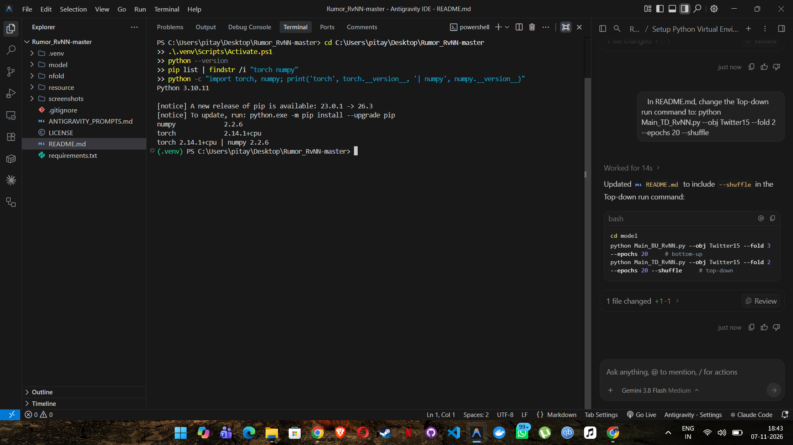
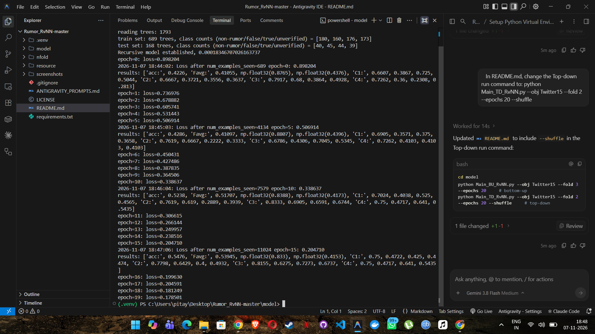
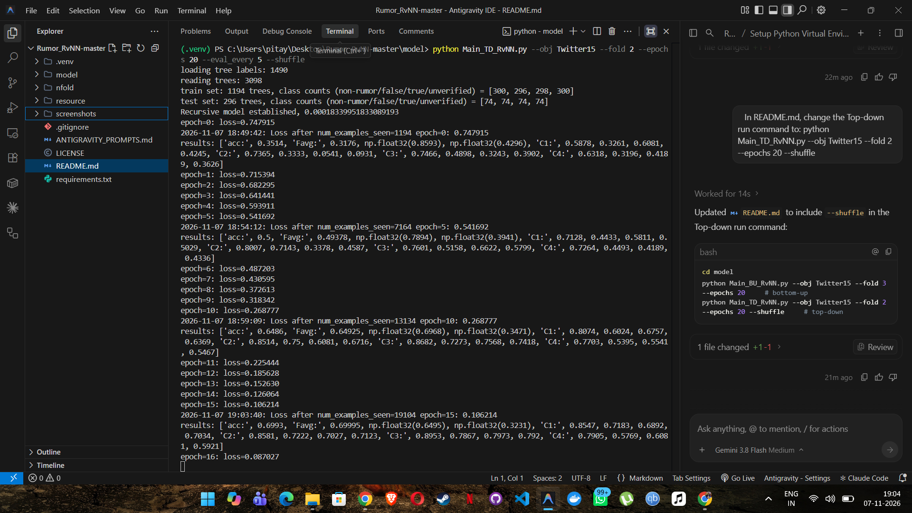

# Rumor Detection on Twitter with Tree-structured Recursive Neural Networks (RvNN)

Debugged and re-implemented version of the code released with
**Ma, Gao, Wong — "Rumor Detection on Twitter with Tree-structured Recursive Neural Networks", ACL 2018.**
Two models are provided: a bottom-up tree GRU (`BU_RvNN`) and a top-down tree GRU (`TD_RvNN`), both classifying a
Twitter conversation tree into 4 classes: **non-rumor / false / true / unverified** (Twitter15 and Twitter16 datasets).

## What was wrong with the original code and what I changed

| Problem in original repo | Fix |
|---|---|
| Written for **Python 2** (`print x`, `reload(sys)`, `sys.setdefaultencoding`, `dict.has_key`) | Ported to Python 3 |
| Needs **Theano 0.8.2** + numpy 1.11 (`theano.compat.python2x` no longer exists; Theano is unmaintained and does not install on current Python) | Re-implemented the models in **PyTorch** with the same architecture, same math (GRU with Theano-style `hard_sigmoid`, squared-error loss, gradient clipping at 5, SGD) |
| `evaluate.py` referenced an undefined `outevalPath` in `evaluation()` | Made it a parameter |
| Hard-coded `obj`, `fold`, `Nepoch` inside the scripts | Command-line arguments (`--obj --fold --epochs --lr ...`) |
| Loader code duplicated in both scripts | Shared helpers in `model/common.py` |
| Original "momentum" never took effect (the velocity was a constant `0.` at graph-build time) | Kept the same behaviour (clipped plain SGD) and documented it in `sgd_clip_step` |

## Project layout

```
model/
  BU_RvNN.py        bottom-up tree GRU + tree construction
  TD_RvNN.py        top-down tree GRU + tree construction
  Main_BU_RvNN.py   train / evaluate bottom-up model
  Main_TD_RvNN.py   train / evaluate top-down model
  common.py         data loading helpers
  evaluate.py       accuracy / precision / recall / F1 for 4 classes
nfold/              5-fold train/test splits
resource/           pre-processed trees and labels
```

## Setup

```bash
python -m venv .venv
# Windows: .venv\Scripts\activate     macOS/Linux: source .venv/bin/activate
pip install -r requirements.txt
```

## Run

```bash
cd model
python Main_BU_RvNN.py --obj Twitter15 --fold 3 --epochs 20 --eval_every 5
python Main_TD_RvNN.py --obj Twitter15 --fold 2 --epochs 20 --eval_every 5 --shuffle
```

Options: `--obj {Twitter15,Twitter16}`, `--fold {0..4}`, `--epochs N` (paper setting: 500 BU / 600 TD),
`--lr`, `--eval_every`, `--max_samples` (quick smoke test), `--seed`.

## Results (screenshots)

### Environment / dependencies installed

*Environment setup: Python, PyTorch and NumPy versions*

### Bottom-up RvNN — training and evaluation

*Bottom-up RvNN (Twitter15, fold 3, 20 epochs)*

### Top-down RvNN — training and evaluation

*Top-down RvNN (Twitter15, fold 2, 20 epochs, --shuffle)*

### Final metrics

| Model | Dataset / fold | Epochs | Accuracy | Macro-F1 |
|---|---|---|---|---|
| BU-RvNN | Twitter15 / 3 | 20 | 0.5357 | 0.5276 |
| TD-RvNN | Twitter15 / 2 | 20 | 0.6993 | 0.69995 |

Metrics are from the last evaluation (epoch 15 of 20; the script evaluates every 5 epochs). The two models were evaluated on different folds and for only 20 epochs (the paper uses 500-600), so the numbers should not be compared directly with each other or with the paper.

### Note on shuffling

The original top-down script had shuffling disabled. The training files are sorted by class, so without shuffling the model collapsed to predicting one class (accuracy about 0.27). The --shuffle flag fixes this.

## Citation

Jing Ma, Wei Gao, Kam-Fai Wong. ACL 2018. Datasets from Ma et al., ACL 2017.
